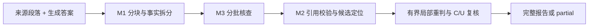

# Citation Grounding & Faithfulness Verifier

将生成答案拆成事实声明，仅依据给定来源判断 `SUPPORTED`、`CONTRADICTED` 或 `UNSUPPORTED`，并返回逐字引文。实现 [Gist 作业](https://gist.github.com/wsxiaoys/849522ee389e0ce359ef444653084484)要求的 HTTP 服务、20+ 标注案例和三方案评测。

**当前发布主线是 `optimized-v4.0`。** Python 3.11+，仅使用标准库，无需安装第三方依赖。默认模型为 `deepseek-flash`，通过 Chat Completions 兼容接口调用。代码校验保证结构、引用下标及原文子串合法；语义判断仍依赖模型。



M1 决定原子粒度，没有运行时语义合并阶段。模型输出经过代码校验；格式问题可有限修复，内容不同的引文必须重新判定。失败与未完成项保留，不伪装成 `UNSUPPORTED`。

## 快速启动

将 [.env.example](.env.example) 复制为仓库根目录的 `.env`，填写 `LLM_API_KEY`，然后运行：

```sh
python -m grounding.server
```

默认启动 v4.0，并加载仓库内 [configs/optimized-v4.0.json](configs/optimized-v4.0.json)。等价的显式命令：

```sh
python -m grounding.server --backend optimized-v4.0 --v4-config configs/optimized-v4.0.json
```

`optimized`、`optimized-v4` 均指向 v4.0；历史版本使用明确名称 `optimized-v2`、`optimized-v3`。无需密钥的离线服务为 `python -m grounding.server --backend baseline`。`GET /health` 返回服务状态和后端名称。

默认绑定 `127.0.0.1:8000`，可用 `--host`、`--port` 修改。配置优先级为显式参数、进程环境、`.env`、默认值；v4 的 thinking、输出预算和重试上限由分阶段 JSON 配置控制。

在另一个 PowerShell 窗口发送已有的 SQLite 示例：

```powershell
$body = Get-Content -Raw -Encoding UTF8 examples/sqlite.json
Invoke-RestMethod -Uri http://127.0.0.1:8000/verify -Method Post -ContentType "application/json; charset=utf-8" -Body ([Text.Encoding]::UTF8.GetBytes($body)) | ConvertTo-Json -Depth 10
```

## API 契约

`POST /verify`，`Content-Type: application/json`；请求只含两个字段：

```json
{
  "context_passages": ["The configured retry limit is three."],
  "generated_answer": "The configured retry limit is four."
}
```

完整成功返回 HTTP 200，结构如下；模型需给出实际判决及理由：

```json
{
  "claims": [{
    "claim_text": "The configured retry limit is four.",
    "verdict": "CONTRADICTED",
    "reasoning": "The source specifies a retry limit of three.",
    "citations": [{"index": 0, "quote": "The configured retry limit is three."}]
  }]
}
```

`SUPPORTED` 表示来源充分蕴含；`CONTRADICTED` 需要直接反证；缺少来源依据为 `UNSUPPORTED`，即使常识上为真。前两类必须有引文，U 的 `citations` 必须为 `[]`。引用下标为零基，`quote` 必须是该段的精确子串；可选字符偏移采用 Unicode 字符的半开区间。

**部分成功也是 HTTP 200**，在成功 `claims` 外增加 `status:"partial"` 和非空 `errors`。调用方须检查这两个字段，不能把已完成部分全 S 理解为整个答案已获支持。另一个包含两条声明的答案可能返回如下结构：

```json
{
  "claims": [{"claim_text": "The configured retry limit is four.", "verdict": "CONTRADICTED", "reasoning": "The stated maximum differs.", "citations": [{"index": 0, "quote": "The configured retry limit is three."}]}],
  "status": "partial",
  "errors": [{"id": "c2", "code": "invalid_model_output", "message": "A second claim could not be completed."}]
}
```

| 边界 | 返回行为 |
| --- | --- |
| 空答案或无事实声明 | `200 {"claims":[]}` |
| 空上下文、有事实声明 | 拆分后各项为 U，无引文 |
| 全部事实项失败 | 错误响应，不返回空成功报告 |
| 非法 JSON / 类型 / 媒体类型 / 超容量 | 400 / 400 / 415 / 413 |
| 上游格式失败 / 超时 / 并发槽位耗尽 | 502 / 504 / 503 |

错误格式为 `{"error":{"code":"...","message":"..."}}`。输入上限：64 段、每段 32,000 字符、答案 20,000 字符、总输入 200,000 字符、body 1 MiB；最多 64 条声明。默认最多四个并行验证请求，每个 v4 请求内最多四个核查工作线程；并发参数会共同影响上游负载。

## 三方案评测

同一入口调用与 HTTP 相同的 `baseline`、`minimal`、`optimized-v4.0` 实现：

```sh
python scripts/benchmark_v4_claims.py --dataset dataset/cphos28/cases.jsonl --split test --backends baseline minimal optimized-v4.0 --v4-config configs/optimized-v4.0.json --output-dir results/comparison
```

输出目录必须不存在。结果保存配置/源码/数据哈希、原始响应、调用用量、完整/部分/失败计数和报告。`minimal` 单次调用、不重试；v4 使用固定分阶段预算，两者是系统比较，不是等算力消融。上述 CPHOS 数据已曝光，只作回归，不冒充新未见测试。

无密钥检查：

```sh
python -m unittest discover -s tests -v
python scripts/validate_dataset.py
python scripts/benchmark_v4_claims.py --dataset dataset/cphos28/cases.jsonl --split dev --backends baseline --output-dir results/baseline-smoke
```

`scripts/benchmark.py` 保留历史 claims-only 评测；它对 v4 明确报错并提示当前入口，避免把合法 partial 当作非法报告。新 180 条 RAGTruth 的原始结果无需 API 即可[离线复算](reports/ragtruth-fresh180-20261024/REPRODUCE.md)。

## 最新 RAGTruth：同批新来源 180 条

2026-10-24，30 个来源 × 6 个回答，QA/Summary/Data2txt 各 60 条。取数前冻结代码、配置和评分；排除历史曝光与重复来源后按固定哈希选择，540 个配对各执行一次。下表为发布整理前、归档于 **`bd51922`** 的冻结系统实测，本次发布收口没有重新调用模型。

| 指标 | baseline | minimal | v4.0 |
| --- | ---: | ---: | ---: |
| 正确判定 / 全部 180 条 | 58，32.22% | 88，48.89% | **103，57.22%** |
| 已决准确率（分母） | 32.22%（180） | 49.72%（177） | 57.87%（178） |
| 已决 F1 | 48.74% | 55.28% | **59.89%** |
| 完整 / 部分 / 错误 | 180 / 0 / 0 | 177 / 0 / 3 | 175 / 5 / 0 |
| 平均 / P95 秒 | 0.007 / 0.016 | 32.207 / 55.250 | 18.413 / 39.796 |
| 记录缓存份额的参考 USD | 0 | 1.4560 | 已知 1.0877；总额未知 |
| 输入全未缓存的参考 USD | 0 | 1.4833 | 已知 1.5484；总额未知 |

主指标差为 **+8.33 个百分点，来源簇 95% 区间 [+0.56, +17.22]**；已决 F1 差为 +4.62 点，区间 **[−0.29, +9.73]**，仍跨零。v4 有 73 个原生 FP、2 个 FN、2 个未决；minimal 另有3个阳性因错误未决，其条件 FN=0不等于全量无漏检。

本批122/180为原生阴性，“永远判干净”的准确率为 **67.78%**，但幻觉召回/F1为零。v4 仍有明显误报，不能把相对收益称为高绝对准确率。有效 partial 的 C/U 可完成回答级检测；全 S partial 保持未决，不计 TN/FN。

v4 两次调用缺 usage，不能认作零费用。费用按预冻结参考单价计算，不是实际账单；阶段 thinking、并发和缓存不同，实测更快不构成单一算法的因果优势。[结果与审计](reports/ragtruth-fresh180-20261024/README.md) · [完整分母与指标解释](docs/RESULTS.md)

## CPHOS 历史三方案比较

原46条标注集覆盖完全支持、细微篡改、外部幻觉和跨段综合；按整道题划分。下表是旧24条 test、32条 gold claim 的 **v2** 实测，不是当前v4分数：

| 方案 | 严格 claim + verdict F1 | 完整报告 | 平均秒 | 参考 USD |
| --- | ---: | ---: | ---: | ---: |
| baseline | 30.77% | 24/24 | 0.0007 | 0 |
| minimal | **89.23%** | 24/24 | 1.9977 | 0.012266 |
| optimized-v2 | 86.57% | 24/24 | 4.9498 | 0.028797 |

v2 的过拆拖累严格文本对齐 F1；这个负结果保留不改写。该指标惩罚改写与粒度差异，不能与 RAGTruth 回答级 F1 横比。[历史报告](reports/test/report.md) · [数据说明](dataset/cphos28/README.md)

## 迭代与已知局限

- v2 → v3.1 改善了同来源物理确认集的粒度；v4取消独立合并，加入分块、引用重判、分批与partial。新180支持本批来源上的正确产出改善；combined、M1-faithful未获得足够整体收益，留在实验历史。
- 小规模组件对照中，M1严格通过为简洁版18/40、当前16/40；固定claim的M3有效且正确为84/90、85/90；27次复核没有标签翻转，且进入复核的初判都正确，不能据此断言复核无用。[版本与实验索引](docs/HISTORY.md)
- 180条中有136次拆分格式修复、79个降级块、567条句骨架和183次引文重问；完成率、字面覆盖和精确引文均不证明事实保真。
- 仍需收紧语义敏感空白的引文修复，并明确重复文本的来源发生位置。当前系统适合可审阅的核查辅助，不应将自动判决当成已认证事实。
- 推理不按 benchmark、样本ID、领域或金标切换规则。任何用于调优的集合均记为已曝光；原生标签与作者裁定分开保留，详细要求见 [AGENTS.md](AGENTS.md)。

当前目录提供服务、测试、核心数据与代表性报告；完整研究、人工审阅草案和冻结快照保存在 [develop 的固定归档提交](https://github.com/yixiaogithub66/citation-grounding-verifier/tree/bd51922)。运行服务与常规评测不需要本机原PDF、研究工具或Gemini CLI。
