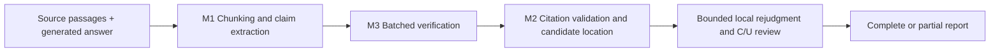

# Citation Grounding & Faithfulness Verifier

**English** | [简体中文](README.zh-CN.md)

Decompose generated answers into factual claims, classify them as `SUPPORTED`, `CONTRADICTED`, or `UNSUPPORTED` using only the supplied sources, and return verbatim citations. This repository implements the HTTP service, 20+ labeled cases, and three-way evaluation required by the [Gist assignment](https://gist.github.com/wsxiaoys/849522ee389e0ce359ef444653084484).

**The current release is `optimized-v4.0`.** Python 3.11+, standard library only; no third-party dependencies to install. The default model is `deepseek-flash`, accessed through a Chat Completions-compatible API. Code validates response structure, citation indices, and exact source substrings; semantic judgments still depend on the model.



M1 determines claim granularity; there is no runtime semantic merge stage. Model outputs are validated in code. Format errors receive bounded repair; content-changing quotations require a new judgment. Failures and unfinished claims remain explicit rather than becoming fabricated `UNSUPPORTED` verdicts.

## Quick start

Copy [.env.example](.env.example) to `.env` in the repository root, set `LLM_API_KEY`, and run:

```sh
python -m grounding.server
```

This starts v4.0 and loads the repository's [configs/optimized-v4.0.json](configs/optimized-v4.0.json). The equivalent explicit command is:

```sh
python -m grounding.server --backend optimized-v4.0 --v4-config configs/optimized-v4.0.json
```

Both `optimized` and `optimized-v4` select v4.0. Use `optimized-v2` or `optimized-v3` explicitly for historical versions. For an offline service without an API key, run `python -m grounding.server --backend baseline`. `GET /health` returns the service status and backend name.

The default address is `127.0.0.1:8000`; change it with `--host` and `--port`. Configuration precedence is explicit arguments, process environment, `.env`, then defaults. The v4 stage configuration controls thinking, output budgets, and retry limits.

Send the included SQLite example from another PowerShell window:

```powershell
$body = Get-Content -Raw -Encoding UTF8 examples/sqlite.json
Invoke-RestMethod -Uri http://127.0.0.1:8000/verify -Method Post -ContentType "application/json; charset=utf-8" -Body ([Text.Encoding]::UTF8.GetBytes($body)) | ConvertTo-Json -Depth 10
```

## API contract

`POST /verify`, with `Content-Type: application/json`. Requests contain exactly two fields:

```json
{
  "context_passages": ["The configured retry limit is three."],
  "generated_answer": "The configured retry limit is four."
}
```

A complete result returns HTTP 200 with the following structure; the model supplies the actual verdict and explanation:

```json
{
  "claims": [{
    "claim_text": "The configured retry limit is four.",
    "verdict": "CONTRADICTED",
    "reasoning": "The source specifies a retry limit of three.",
    "citations": [{"index": 0, "quote": "The configured retry limit is three."}]
  }]
}
```

`SUPPORTED` means fully entailed by the sources; `CONTRADICTED` requires direct counterevidence. A claim without source support is `UNSUPPORTED`, even if true in the real world. S and C require citations; U requires `citations: []`. Indices are zero-based, and each `quote` must be an exact substring of its passage. Optional offsets use half-open Unicode character ranges.

**Partial results also return HTTP 200**, adding `status:"partial"` and a nonempty `errors` array alongside completed `claims`. Callers must inspect these fields: all-S completed claims do not establish support for the entire answer. A different answer containing two claims could produce:

```json
{
  "claims": [{"claim_text": "The configured retry limit is four.", "verdict": "CONTRADICTED", "reasoning": "The stated maximum differs.", "citations": [{"index": 0, "quote": "The configured retry limit is three."}]}],
  "status": "partial",
  "errors": [{"id": "c2", "code": "invalid_model_output", "message": "A second claim could not be completed."}]
}
```

| Edge case | Response |
| --- | --- |
| Empty answer or no factual claims | `200 {"claims":[]}` |
| Empty context with factual claims | Extract claims and return U without citations |
| All factual claims fail | Error response, not an empty successful report |
| Invalid JSON / type / media type / capacity exceeded | 400 / 400 / 415 / 413 |
| Upstream format failure / timeout / no available concurrency slot | 502 / 504 / 503 |

Errors use `{"error":{"code":"...","message":"..."}}`. Input limits: 64 passages, 32,000 characters per passage, 20,000 answer characters, 200,000 total input characters, and a 1 MiB body; at most 64 claims. By default, up to four verification requests run concurrently, with up to four verification workers per v4 request. Both settings affect upstream load.

## Compare three approaches

The same entry point runs the `baseline`, `minimal`, and `optimized-v4.0` implementations used by HTTP:

```sh
python scripts/benchmark_v4_claims.py --dataset dataset/cphos28/cases.jsonl --split test --backends baseline minimal optimized-v4.0 --v4-config configs/optimized-v4.0.json --output-dir results/comparison
```

The output directory must not exist. Each run saves configuration/source/data hashes, raw responses, call usage, complete/partial/error counts, and a report. `minimal` makes one call without retries; v4 uses fixed stage budgets. This is a system comparison, not an equal-compute ablation. The CPHOS data above has already been exposed and is used for regression, not as a new unseen test.

Checks that require no API key:

```sh
python -m unittest discover -s tests -v
python scripts/validate_dataset.py
python scripts/benchmark_v4_claims.py --dataset dataset/cphos28/cases.jsonl --split dev --backends baseline --output-dir results/baseline-smoke
```

`scripts/benchmark.py` retains the historical claims-only evaluation. It rejects v4 and points to the current runner, avoiding incorrect rejection of valid partial reports. The fresh 180-answer RAGTruth results can be [rescored offline](reports/ragtruth-fresh180-20261024/REPRODUCE.md) without an API.

## Latest RAGTruth: 180 answers from new sources

2026-10-24: 30 sources × 6 answers, with 60 answers each from QA, Summary, and Data2txt. Code, configuration, and scoring were frozen before selection. Previously exposed and duplicate sources were excluded before fixed-hash selection; each of the 540 answer/backend pairs ran once. These results come from the frozen system archived at **`bd51922`**, before release preparation; no model inference was rerun for this release.

| Metric | baseline | minimal | v4.0 |
| --- | ---: | ---: | ---: |
| Correct decisions / all 180 answers | 58, 32.22% | 88, 48.89% | **103, 57.22%** |
| Resolved-only accuracy (denominator) | 32.22% (180) | 49.72% (177) | 57.87% (178) |
| Resolved-only F1 | 48.74% | 55.28% | **59.89%** |
| Complete / partial / error | 180 / 0 / 0 | 177 / 0 / 3 | 175 / 5 / 0 |
| Mean / P95 seconds | 0.007 / 0.016 | 32.207 / 55.250 | 18.413 / 39.796 |
| Reference USD using recorded cache shares | 0 | 1.4560 | Known subtotal 1.0877; total unknown |
| Reference USD with all inputs priced as cache misses | 0 | 1.4833 | Known subtotal 1.5484; total unknown |

The primary metric improves by **+8.33 percentage points, with a source-cluster 95% interval of [+0.56, +17.22]**. The resolved-only F1 difference is +4.62 points, with an interval of **[−0.29, +9.73]**, which still crosses zero. V4 has 73 native-label FP, 2 FN, and 2 unresolved answers. Minimal has 3 additional positive answers unresolved due to errors; its conditional FN=0 does not mean zero misses across all answers.

Native negatives account for 122/180 answers. An "always clean" predictor would achieve **67.78%** accuracy, but zero hallucination recall/F1. V4 still over-reports problems; relative improvement is not high absolute accuracy. A valid partial report containing C/U can establish answer-level detection; all-S partial reports remain unresolved and count as neither TN nor FN.

Two v4 calls lack usage data and cannot be treated as free. Costs use frozen reference prices, not actual invoices. Stage thinking, concurrency, and caching differ, so lower observed latency does not establish a causal advantage for any single algorithm. [Results and audits](reports/ragtruth-fresh180-20261024/README.md) · [Full denominators and metric definitions](docs/RESULTS.md)

## Historical CPHOS comparison

The original 46 labeled cases cover fully supported answers, subtle distortions, extrinsic hallucinations, and multi-passage synthesis, split by whole problem. The table below reports the historical **v2** run on 24 test cases and 32 gold claims, not current v4 performance:

| Approach | Strict claim + verdict F1 | Complete reports | Mean seconds | Reference USD |
| --- | ---: | ---: | ---: | ---: |
| baseline | 30.77% | 24/24 | 0.0007 | 0 |
| minimal | **89.23%** | 24/24 | 1.9977 | 0.012266 |
| optimized-v2 | 86.57% | 24/24 | 4.9498 | 0.028797 |

Over-splitting reduced v2's strict text-alignment F1; that negative result is preserved. This metric penalizes paraphrasing and granularity differences and cannot be compared directly with RAGTruth answer-level F1. [Historical report](reports/test/report.md) · [Dataset notes](dataset/cphos28/README.md)

## Iteration and known limitations

- v2 → v3.1 improved granularity on a same-source physics confirmation set. V4 removed the separate merge stage and added chunking, citation rejudgment, batching, and partial reports. The new 180-answer run supports improved correct-decision yield on these sources; combined and M1-faithful did not demonstrate sufficient overall benefit and remain experimental history.
- In a small component comparison, strict M1 passes were 18/40 for the concise variant and 16/40 for the current one. With fixed claims, M3 produced 84/90 and 85/90 valid, correct results. The 27 reviews changed no labels, and all initial labels entering review were correct, so this does not show that review is useless. [Version and experiment index](docs/HISTORY.md)
- The 180-answer run required 136 decomposition format repairs, 79 fallback chunks, 567 sentence skeletons, and 183 citation requeries. Completion, character coverage, and exact quotations do not establish factual fidelity.
- Quote repair still needs stricter handling of semantically significant whitespace, and repeated text needs explicit source-occurrence identification. The system is intended as verification assistance with reviewable evidence, not as a source of certified facts.
- Inference does not switch rules by benchmark, sample ID, domain, or gold label. Any dataset used for tuning is marked exposed; native labels and author adjudication remain separate. See [AGENTS.md](AGENTS.md).

This tree contains the service, tests, core data, and representative reports. Full research, human-review drafts, and frozen snapshots remain at the [fixed develop archive commit](https://github.com/yixiaogithub66/citation-grounding-verifier/tree/bd51922). Running the service and routine evaluations requires neither the original local PDFs nor research tools or the Gemini CLI.
